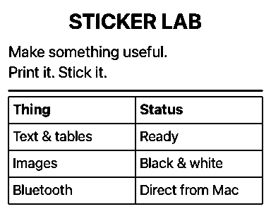

# S1 Sticker

Turn a prompt, photo, checklist, or table into a sticker on the iDPRT S1. S1 Sticker is a pair of native Swift apps for macOS and iPhone, built around a shared rendering and printer protocol core.



- Print text, images, and the first page of a PDF over Bluetooth.
- Preview the monochrome result, rotate artwork, and dither photos for thermal printing.
- Generate artwork or text using an OpenAI API key stored in the device Keychain.
- Print from Raycast on the Mac or the iPhone share sheet.
- Use the optional Wi-Fi bridge to send a job from a phone through the Mac.

The printer has a 384-dot, 48 mm printhead. The renderer trims blank leading rows and feeds 10 mm after the image for cutting. Tested with an iDPRT S1; other models are not supported or tested. This is an independent project and is not affiliated with iDPRT.

## Build the Mac app

Requirements: macOS 13 or later, Xcode, [XcodeGen](https://github.com/yonaskolb/XcodeGen), and an Apple Development signing identity. The layered app icon also requires an Xcode version that supports Icon Composer assets. The build script signs with an existing local development identity and installs to `~/Applications/S1 Sticker.app`.

```sh
./build.sh
./bin/s1 --status
```

Use `./build.sh --build-only` to build without installing. Pair the printer in macOS Bluetooth settings and keep it on. The printer may appear disconnected between jobs; the app opens a connection when needed. The device must not be in use by another phone or app.

## Build for iPhone

Run `xcodegen generate`, open `S1Sticker.xcodeproj`, and select the `S1Pocket` scheme. Set your development team and unique bundle identifiers for the app and share extension in Xcode before installing on your device. The iPhone app uses CoreBluetooth directly; it does not require the Mac bridge.

## AI and privacy

AI generation is optional and uses the OpenAI API, which is billed separately from ChatGPT. Add your own API key in **AI settings** on each device; it is stored in that device's Keychain. Prompts and requested content are sent to OpenAI when using generation. Local printing and previews do not require an API key.

## Print from the command line

```sh
./bin/s1 --text '# Shopping list'
./bin/s1 --print /absolute/path/photo.jpg --dither
./bin/s1 --render examples/sticker-lab.json --output /tmp/sticker.png
./bin/s1 --ai-image 'A sleepy cat in a teacup'
```

`--render` saves a preview without printing. JSON layout blocks are illustrated in `examples/sticker-lab.json`. Image rotation is available with `--rotate auto`, `0`, `90`, `180`, or `270`. A partially transmitted job is not automatically retried.

Add the scripts in `raycast/` to Raycast's Script Commands directory to print text, clipboard contents, or an AI prompt. AI commands use the Mac app's saved API key.

## Optional: keep the printer ready

S1 Keep Ready is an experimental Mac login helper. It periodically checks the printer and releases its connection when a Mac print request arrives, then reconnects. Use it with the printer plugged in and the Mac awake. It cannot detect charging, wake a powered-off printer, or operate while the Mac sleeps. Status handoffs have been tested; physical printing during the handoff still needs verification.

```sh
python3 scripts/keep-ready.py install
python3 scripts/keep-ready.py status
python3 scripts/keep-ready.py uninstall
```

Uninstall removes the helper, not the app or its settings. Stop it before using the printer directly from a phone.

## Optional: phone-to-Mac bridge

Run `python3 install_bridge.py` to start the bridge as a login service. The phone and Mac must be on the same network, and the Mac must be awake. Use **Pair iPhone** in the Mac app to open a private pairing QR. Anyone with that pairing credential can request prints, so keep it private.

## Development

`Shared/Core` renders and encodes labels; `Shared/AI` handles optional generation; `Shared/UI` manages previews. `macOS/` contains the desktop app and RFCOMM transport; `ios/` contains the phone app, BLE transport, and share extension. `AGENTS.md` includes the printer formatting profile bundled into the apps.

```sh
swift test
```

The Python integration tests require Pillow and an installed Mac app, or `S1_TEST_BINARY` pointing to a built executable. They render and validate CLI behavior without printing:

```sh
python3 -m unittest discover -s tests -p 'test_*.py'
```

The protocol implementation uses status and identity commands and 32-row raster packets. The [manufacturer's S1 guide](https://foreverfile.hprtcloud.com/knowledge/2025-04-22/20250422093437_520603208%2BiDPRT%2BS1%2B%E4%BD%BF%E7%94%A8%E8%AF%B4%E6%98%8E%E4%B9%A6%2B%E8%8B%B1%E5%BE%B7%E6%B3%95%E8%A5%BF%E6%84%8F%E6%97%A5_REV.1.0.pdf) and [HPRT example code](https://github.com/dizys/RYCommunication/blob/master/Example-macOS/Class/Cmd/Poooli/PoooliCmdGenerator.m) informed the investigation. No firmware or persistent printer setting is changed.
